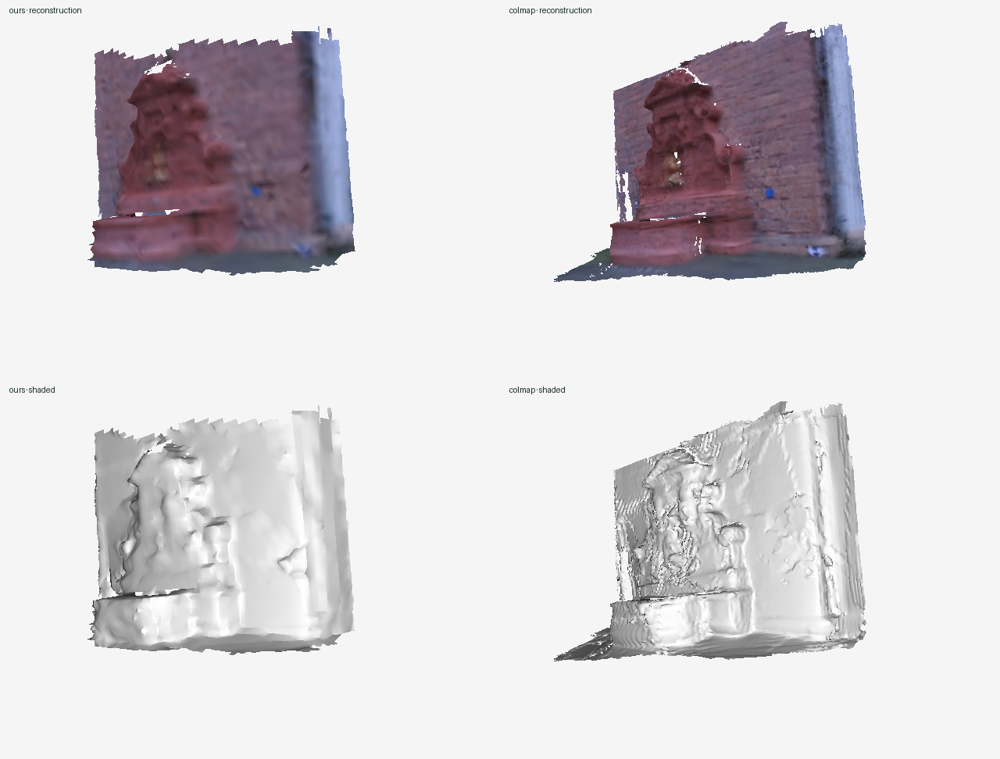

# Measured classical experiment results

Two-method projection on 19 November 2026 of measurements recorded on 18 November. Scores are retained unchanged; comparison figures are regenerated. This is not a new reconstruction run. Source hashes and projection scope are in `validation/experiments_20261119_classical/derivation.json`.

Executed sequentially: E1 → E2 → E3 → E4 → E5 → E6 → E7 → M4 → M5. Completed experiments include failed method attempts; completion does not mean every reconstruction succeeded.

| Stage | Work executed | Status | Results |
| --- | --- | --- | --- |
| E1 | Our SfM / CPU COLMAP on car, fountain, calibrated Temple | completed | [Measured table](../validation/experiments_20261119_classical/E1/RESULTS.md) |
| E2 | No BA / local / local + global BA on car and Temple | completed | [Measured table](../validation/experiments_20261119_classical/E2/RESULTS.md) |
| E3 | Car 5/10/20/30 views; Temple 5/10/16; both methods | completed | [Measured table](../validation/experiments_20261119_classical/E3/RESULTS.md) |
| E4 | SIFT / RootSIFT / ORB on car and fountain | completed | [Measured table](../validation/experiments_20261119_classical/E4/RESULTS.md) |
| E5 | Approximate / calibrated / shared-focal BA intrinsics on Temple | completed | [Measured table](../validation/experiments_20261119_classical/E5/RESULTS.md) |
| E6 | Ratio and RANSAC threshold sensitivity on car | completed | [Measured table](../validation/experiments_20261119_classical/E6/RESULTS.md) |
| E7 | Glossy car, sparse views, controlled blur, low-texture Dino | completed | [Measured table](../validation/experiments_20261119_classical/E7/RESULTS.md) |
| M4 | Original EPFL fountain GT mesh: accuracy, completeness, F-scores, error colors | completed | [Measured table](../validation/experiments_20261119_classical/M4/RESULTS.md) |
| M5 | Our SfM + COLMAP with the same mono backend; GT-aligned side-by-side | completed | [Measured table](../validation/experiments_20261119_classical/M5/RESULTS.md) |

## Findings

- E1 Temple: our SfM registered 16/16 cameras with 0.270% aligned camera ATE; COLMAP registered 13/16 with 0.094% ATE. Missing-camera penalties are reflected in pose AUC, so ATE alone is insufficient.
- E2 Temple: local/global BA reduced ATE from 0.377% to 0.270%. On the car, lower reprojection error did not fix wrong global geometry or missing cameras.
- E3 more images did not guarantee better results. Sparse or disconnected overlap caused outright failures and two-camera partial reconstructions. Undefined global ATE is shown as missing, while valid relative-pose metrics are retained.
- E4 ORB failed car initialization but reconstructed all fountain cameras. Detector performance was scene dependent.
- E5 calibrated Temple K gave 0.270% ATE, approximate K 6.970%, and shared-focal BA 8.297%. The optional focal optimizer passed a controlled synthetic recovery test but failed to recover true calibration here. The user approved Temple because real car checkerboard calibration was unavailable.
- E6 car results were highly sensitive to thresholds; changing the ratio to 0.7 reduced pseudo-reference ATE to 0.935% but still registered only 10/20 cameras. This does not replace the frozen baseline or establish a universal best threshold.
- E7 sparse car and blurred Temple caused classical initialization failures.

## Mesh measurements

| Source | Fused views | Faces | Accuracy % GT diagonal ↓ | Completeness % ↓ | F@1% ↑ | Render coverage |
| --- | ---: | ---: | ---: | ---: | ---: | ---: |
| ours | 8 | 8632 | 3.205 | 10.087 | 0.059 | 0.772 |
| colmap | 8 | 87512 | 2.165 | 9.366 | 0.098 | 0.835 |

Interactive meshes: [ours](../validation/experiments_20261119_classical/M4/ours/interactive_mesh.html), [COLMAP](../validation/experiments_20261119_classical/M5/colmap/interactive_mesh.html).

## Interpretation and reproducibility

Car and E1 fountain pose comparisons use COLMAP pseudo-references, not GT. Temple/Dino have supplied GT cameras; M4/M5 use the real original fountain GT triangle model. E1 car curation previously used COLMAP poses, and the relaxed configuration was previously tuned on Temple. These are development experiments, not an unseen generalization benchmark.

The M4/M5 comparison uses camera-center Sim(3), GT-box crop and 200k samples per direction; it is not the official EPFL visibility-aware scorer. Classical meshing shares Depth Anything V2 Small and parameters, but source landmarks/ROI/depth alignment remain coupled with camera quality. Rendering checks exclude maps from fusion, not from all-view camera estimation. Coverage accompanies masked PSNR/SSIM; meshes remain partial and may be non-watertight.

Protocol and commands: [EXPERIMENTS.md](EXPERIMENTS.md). Compact evidence is retained in `validation/experiments_20261119_classical/`; full input hashes, logs, photos, arrays and meshes remain in ignored `results/experiments_20261118/` and `data/`. Original GT/weights are not redistributed. No final IEEE report, narrated course demo, submission upload, or GitHub push is implied by this experiment record.

The final test result is recorded in `validation/experiments_20261119_classical/verification.json`.
